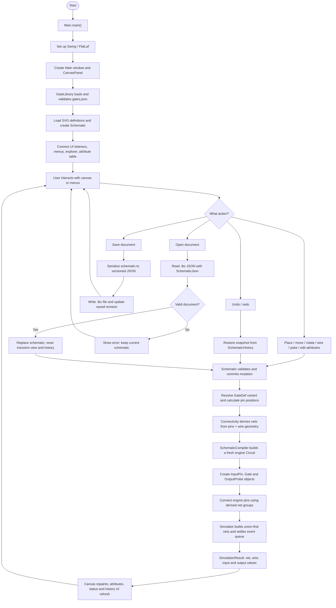

# LogicBench — High-Level Program Flow

The diagram follows the normal desktop lifecycle. The schematic is authoritative; simulation is rebuilt from the schematic rather than being the saved document itself.

## Read the flow

- **Startup:** `Main` creates the window. `CanvasPanel` loads the component catalogue, SVG renderer, and empty editable schematic.
- **Editing:** mouse, keyboard, toolbar, tree, and attribute-table actions are translated into model operations on `Schematic`. Undo/redo restores model snapshots.
- **Geometry and connectivity:** resolved component variants determine pin geometry. `Connectivity` derives nets from the wire segments and pin locations. During geometry-changing edits, the model checks auto-follow paths against the pre-edit nets to avoid accidental shorts.
- **Simulation:** `SchematicCompiler` converts those derived nets to engine pin connections. `Simulator` propagates three-valued logic (`ZERO`, `ONE`, `X`) through scheduled gate evaluations. The UI renders the returned result.
- **Files:** opening validates a detached schematic before replacing the current one. Saving writes the editable schematic; it does not serialize derived nets or simulation caches.

**Important distinction:** `Schematic` is the editable design model; `Circuit` is a derived engine model for one simulation rebuild. Keeping those roles separate lets the editor handle placement, geometry, attributes, files, and history without putting Swing or persistence logic inside the simulator.
